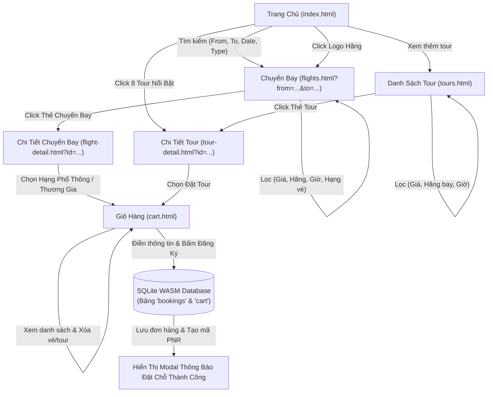

# 🏗️ KIẾN TRÚC HỆ THỐNG & TỔ CHỨC MÃ NGUỒN (ARCHITECTURE)

Website du lịch Vietjet được thiết kế theo mô hình **Multi-Page Application (MPA) Client-Side** hoàn chỉnh, hoạt động độc lập trên mọi trình duyệt hiện đại (Chrome, Edge, Firefox, Safari) mà không yêu cầu máy chủ backend (Node.js/Python/PHP) hay cơ sở dữ liệu server-side riêng biệt.

---

## 1. SƠ ĐỒ CẤU TRÚC THƯ MỤC DỰ ÁN

```text
d:\HA\Viet Jet\
│
├── index.html                 # 🏠 Trang chủ: Tìm kiếm chuyến bay, 8 tour nổi bật, đối tác hàng không
├── flights.html               # ✈️ Trang danh sách chuyến bay: Bộ lọc bên trái, danh sách chuyến bay bên phải
├── flight-detail.html         # 🔍 Trang chi tiết chuyến bay: Thông tin tàu bay, chọn Hạng Phổ Thông/Thương Gia
├── tours.html                 # 🏖️ Trang danh sách tour du lịch: Bộ lọc bên trái, danh sách thẻ tour bên phải
├── tour-detail.html           # 📍 Trang chi tiết tour: Thông tin phương tiện, lịch trình chi tiết theo ngày
├── cart.html                  # 🛒 Trang giỏ hàng & đăng ký đặt chỗ: Xem/xóa vé, nhập thông tin cá nhân, xác nhận
│
├── css/
│   ├── variables.css          # Định nghĩa biến CSS (Màu đỏ #ee1d23, màu vàng #ffc709, font chữ, shadow)
│   ├── style.css              # CSS nền tảng (Reset, typography, header navbar, footer, layout chung)
│   ├── components.css         # CSS tái sử dụng (Thẻ bay, thẻ tour, bộ lọc, modal thông báo, nút bấm)
│   └── responsive.css         # Media query tối ưu cho Mobile (<768px), Tablet (768px-1024px) và Desktop
│
├── js/
│   ├── db.js                  # Cơ sở dữ liệu SQLite: Tải sql.js WebAssembly, seed data, hàm truy vấn SQL
│   ├── main.js                # Logic dùng chung: Cập nhật badge giỏ hàng, mở đóng menu mobile, popup
│   ├── home.js                # Logic trang chủ: Xử lý widget tìm kiếm vé, render 8 tour nổi bật, click logo hãng
│   ├── flights.js             # Logic trang chuyến bay: Đọc URL params, lọc đa điều kiện, sắp xếp giá
│   ├── flight-detail.js       # Logic chi tiết chuyến bay: Đọc ID từ URL, chọn hạng Phổ thông/Thương gia, thêm giỏ hàng
│   ├── tours.js               # Logic trang tour: Lọc theo giá, hãng bay, render thẻ tour
│   ├── tour-detail.js         # Logic chi tiết tour: Đọc ID từ URL, render timeline lịch trình, thêm tour vào giỏ hàng
│   └── cart.js                # Logic giỏ hàng: Hiển thị mục đã chọn, xóa mục, validate form, lưu booking vào SQLite
│
├── Images/                    # Thư mục lưu trữ hình ảnh
│   ├── vietjet-air.png        # Logo chính thức Vietjet
│   ├── airlines/              # Logo các hãng hàng không đối tác (Vietnam Airlines, Bamboo, Singapore Airlines...)
│   └── tours/                 # Ảnh thumbnail tour du lịch (kích thước chuẩn 600x400)
│
├── PRD.md                     # Đặc tả yêu cầu sản phẩm
├── DATABASE_SCHEMA.md         # Thiết kế cơ sở dữ liệu SQLite & dữ liệu khởi tạo
├── ARCHITECTURE.md            # Tài liệu kiến trúc và luồng dữ liệu (File hiện tại)
├── TASK_LIST.md               # Danh sách công việc phân rã từng bước cho Antigravity
└── PROMPTS.md                 # Các mẫu câu lệnh chuẩn dùng để Antigravity sinh mã nguồn
```

---

## 2. LUỒNG DỮ LIỆU & TƯƠNG TÁC (DATA FLOW)



---

## 3. DESIGN SYSTEM (HỆ QUY CHUẨN GIAO DIỆN)

Tất cả các thành phần CSS được đồng bộ qua `css/variables.css`:

```css
:root {
  /* Màu nhận diện thương hiệu Vietjet */
  --primary-color: #ee1d23;         /* Đỏ chủ đạo Vietjet */
  --primary-hover: #c91419;         /* Đỏ đậm khi hover */
  --accent-color: #ffc709;          /* Vàng điểm nhấn */
  --accent-hover: #e6b205;

  /* Nền giao diện sáng */
  --bg-body: #ffffff;               /* Nền trắng tinh khôi */
  --bg-surface: #f8fafc;            /* Nền thẻ / widget phụ */
  --bg-card: #ffffff;
  --border-color: #e2e8f0;          /* Đường viền mỏng tinh tế */

  /* Màu chữ (Typography) */
  --text-primary: #0f172a;          /* Đen sắc nét */
  --text-secondary: #475569;        /* Xám trung tính */
  --text-muted: #94a3b8;            /* Xám nhạt */
  --text-white: #ffffff;

  /* Trạng thái */
  --status-success: #10b981;        /* Xanh thành công */
  --status-warning: #f59e0b;
  --status-error: #ef4444;

  /* Bo góc & Đổ bóng */
  --radius-sm: 6px;
  --radius-md: 10px;
  --radius-lg: 16px;
  --radius-pill: 9999px;
  --shadow-sm: 0 1px 3px rgba(0, 0, 0, 0.05);
  --shadow-md: 0 4px 14px rgba(0, 0, 0, 0.08);
  --shadow-lg: 0 10px 25px rgba(238, 29, 35, 0.12);

  /* Font chữ */
  --font-family: 'Inter', -apple-system, BlinkMacSystemFont, 'Segoe UI', Roboto, sans-serif;
}
```

---

## 4. CHI TIẾT TỪNG TRANG & CÁC THÀNH PHẦN (PAGE COMPONENTS)

### 4.1. Header & Navigation (Dùng chung cho cả 6 trang)
* **Logo Vietjet:** Đặt góc trái, click về `index.html`.
* **Menu liên kết:**
  * Trang Chủ (`index.html`)
  * Chuyến Bay (`flights.html`)
  * Tour Du Lịch (`tours.html`)
  * Giỏ Hàng (`cart.html`): Chứa biểu tượng giỏ hàng kèm số huy hiệu (Badge count) đếm số lượng dịch vụ đang có trong giỏ hàng SQLite.
* **Nút liên hệ hotline:** `1900 1886` nổi bật với icon điện thoại nhấp nháy nhẹ.

### 4.2. Footer (Dùng chung)
* Giới thiệu ngắn về Vietjet.
* Liên kết nhanh chính sách, điều khoản, cẩm nang du lịch.
* Thông tin hỗ trợ khách hàng, chấp nhận các phương thức thanh toán an toàn.

### 4.3. Mô hình lưu trữ trạng thái Giỏ Hàng & SQLite
* Mọi thao tác chọn chuyến bay (hạng Phổ thông / Thương gia) hoặc chọn tour sẽ gọi hàm `addToCart(item)` trong `js/db.js`.
* Hàm này ghi một dòng vào bảng `cart` trong SQLite Database và lưu bản snapshot vào `localStorage`.
* Khi tải bất kỳ trang nào, hàm `updateCartBadge()` sẽ chạy câu lệnh:
  ```sql
  SELECT SUM(quantity) as total FROM cart;
  ```
  để tự động cập nhật số lượng hiển thị trên icon giỏ hàng ở thanh Navbar.

---

## 5. BẢO MẬT & TỐI ƯU TRẢI NGHIỆM NGƯỜI DÙNG (UX/PERFORMANCE)

1. **Tải nhanh (Zero Delay):** Dùng HTML/CSS/JS thuần, tải thư viện `sql.js` từ CDN uy tín có cache trình duyệt cao.
2. **Khả năng Offline-Ready:** Khi đã tải dữ liệu lần đầu, người dùng có thể duyệt chuyến bay, lọc tour, thêm giỏ hàng mà không cần kết nối mạng liên tục.
3. **Responsive Design:**
   * Desktop (> 1024px): Bố cục 2 cột (Cột bộ lọc cố định 300px, cột nội dung linh hoạt chiếm phần còn lại).
   * Tablet (768px - 1024px): Bố cục co giãn, bộ lọc có thể thu gọn.
   * Mobile (< 768px): Bộ lọc chuyển thành nút bấm bật ngăn kéo (Drawer/Modal bottom sheet), hiển thị thẻ vé và tour dạng cột đơn dễ vuốt chạm.
